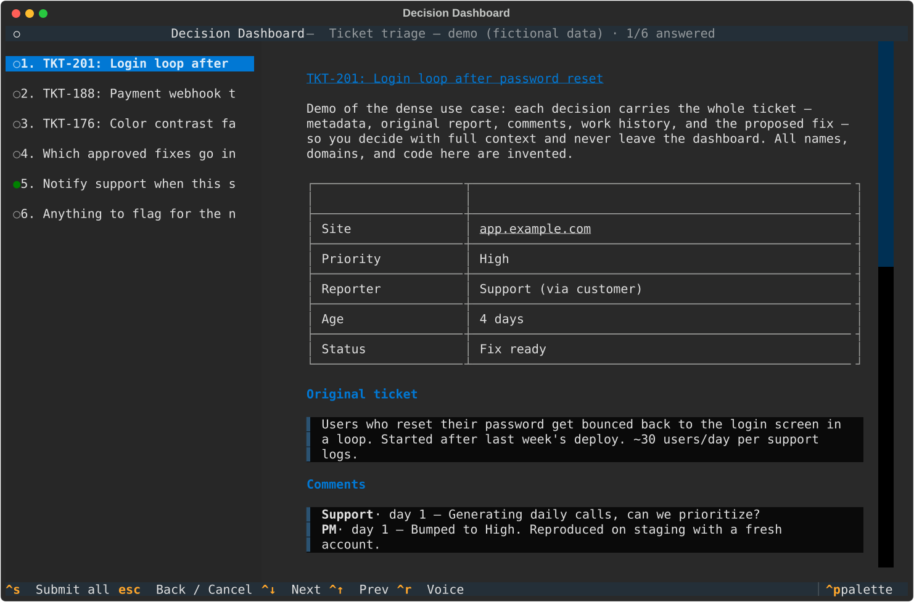

# decision-tui

A terminal-native **decision dashboard** for Claude Code. When the agent needs
you to make decisions — especially several at once, or one with dense context
(tickets, tradeoff tables, diffs, links) — it opens an interactive TUI in a tmux
popup instead of dumping prose or using the built-in question picker. You answer
in a structured UI; the answers go straight back to the model as data.

The agent generates *data* (a JSON decision spec), never UI code — so generation
stays reliable and the renderer is swappable.



## Quick start

See **[SETUP.md](SETUP.md)** for the full Ghostty/tmux/Claude Code walkthrough.
Short version:

```bash
git clone https://github.com/Jacob-Rambo/decision-tui && cd decision-tui
uv tool install -e .
ln -s "$PWD/bin/decision-tui-popup" ~/.local/bin/decision-tui-popup
claude mcp add decision-dashboard --scope user -- decision-tui-mcp   # register the tool
bin/sync-skills                                                       # install the skill
# then add the PreToolUse hook from SETUP.md to ~/.claude/settings.json
```

Try it without Claude:

```bash
decision-tui-popup examples/sample-spec.json /tmp/answers.json   # needs tmux
decision-tui --validate examples/sample-spec.json                # validate a spec
cat /tmp/answers.json
```

Keys: arrows navigate decisions (`ctrl+up`/`down` from anywhere), `tab` moves
focus, `ctrl+s` submits (blocked until all required decisions are answered),
`esc` cancels. In any text field: `ctrl+r` dictates (local voice), `ctrl+c`
clears.

## Features

- **Multi-decision** sidebar; rich markdown context per decision (tables, diffs,
  evidence).
- **Single / multi / yes-no / free-text** answers, an auto-appended "Other…"
  option, and per-decision notes.
- **Clickable links** — `http`/`https`/`mailto` open in your browser, `file:`
  links in your default viewer; bare URLs are autolinked.
- **Local voice dictation** in text fields (`ctrl+r`) via faster-whisper — audio
  never leaves your machine.
- **Auto-growing** text boxes; `ctrl+c` clears a field.
- **Multi-tab aware** — the popup opens on the tab running Claude and rings that
  tab's bell so you can spot it.

## How Claude uses it

The primary path is the **MCP server** (`decision_tui/mcp_server.py`, entry point
`decision-tui-mcp`): one tool, `present_decisions(title, decisions)`, which runs
the popup and returns the answers as a real MCP tool result — the model receives
structured data, no native question UI, no polling. A `PreToolUse` hook
(`bin/askuserquestion-dashboard-hook`) redirects native `AskUserQuestion` calls
to this tool (instant deny — never blocks).

The `decision-dashboard` skill (`skills/decision-dashboard/SKILL.md`) documents
the spec/answers schema and a manual fallback (`decision-tui-popup spec answers`
→ read the answers file) for when the MCP tool isn't available.

## Concurrency & routing

tmux **silently discards** `display-popup` when a client already shows one (exit
0, command never runs — verified on tmux 3.6). `bin/decision-tui-popup`
serializes popups per client with `flock`, so concurrent dashboards queue and
appear one after another. It also targets the client (tab) attached to the
launching session, so the popup lands on the tab running Claude — including for
sub-agent calls. The app traps `SIGTERM`/`SIGHUP` and writes a `cancelled`
answers file, so every termination path ends the caller's wait. Split-pane
dashboards coexist without coordination.

## Why tmux

Claude Code's tools run with no controlling TTY, so they can't draw a TUI over
your session. tmux's server socket lets a TTY-less process spawn an interactive
`display-popup`. No tmux → the MCP tool reports `unavailable` and Claude uses its
native picker. (A tmux-less path that opens a fresh terminal window is planned.)

## Dev

```bash
uv sync
uv run python scripts/smoke_test.py   # headless pilot test of all answer types + cancel
uv tool install -e . --force          # (re)install the CLI shims
```

## License

MIT
