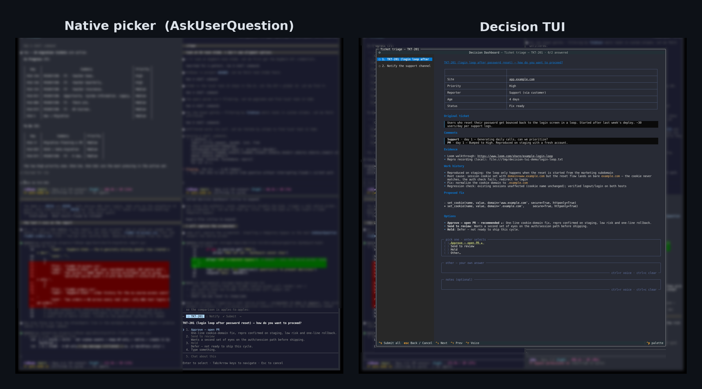

# Decision TUI

A terminal decision dashboard for Claude Code. When the agent needs you to make
decisions, one with heavy context or several at once, it opens a TUI in a tmux
popup instead of printing prose or using the built-in question picker. You answer
in the UI and the answers go back to the model as structured data.

The agent emits a JSON spec, not UI code, so generation stays separate from the
renderer.


## Install

Needs Python 3.12+, uv, tmux, and Claude Code. SETUP.md has the full walkthrough.
Short version:

```bash
git clone https://github.com/Jacob-Rambo/decision-tui && cd decision-tui
uv tool install -e .
ln -s "$PWD/bin/decision-tui-popup" ~/.local/bin/decision-tui-popup
claude mcp add decision-dashboard --scope user -- decision-tui-mcp
bin/sync-skills
```

Then add the PreToolUse hook from SETUP.md so Claude routes its question picker
to the dashboard.

## Try it without Claude

```bash
decision-tui-popup examples/sample-spec.json /tmp/answers.json   # needs tmux
decision-tui --validate examples/sample-spec.json
cat /tmp/answers.json
```

Keys: arrows move between decisions (ctrl+up/down from anywhere), tab moves
focus, ctrl+s submits, esc cancels. In a text field, ctrl+r dictates and ctrl+c
clears.

## Features

- Multiple decisions in one view, each with markdown context (tables, diffs, evidence).
- Single, multi, yes/no, and free-text answers, plus an "Other" option and per-decision notes.
- Clickable links: http/https/mailto open in the browser, file: in the default viewer. Bare URLs are linkified.
- Voice dictation in text fields (ctrl+r) via faster-whisper. Audio stays on the machine.
- Text boxes grow with their content; ctrl+c clears one.
- Opens on the tab running Claude and rings that tab's bell.

## Native picker vs Decision TUI

The built-in `AskUserQuestion` picker takes one question with a few options and
no room for context. The dashboard shows the whole decision (ticket, evidence,
tradeoffs, links) and collects several answers at once.



## How Claude uses it

The MCP server (`decision_tui/mcp_server.py`, command `decision-tui-mcp`) exposes
one tool, `present_decisions(title, decisions)`. It runs the popup and returns
the answers as a tool result, so the model gets structured data with no question
UI and no polling. A PreToolUse hook (`bin/askuserquestion-dashboard-hook`)
redirects native AskUserQuestion calls to it.

The decision-dashboard skill (`skills/decision-dashboard/SKILL.md`) has the
spec/answers schema and a manual fallback for when the MCP tool isn't available.

## Concurrency and routing

tmux discards `display-popup` when the client already shows one, so
`bin/decision-tui-popup` serializes popups per client with flock; concurrent
dashboards queue. It targets the client attached to the launching session, so the
popup lands on the tab running Claude, including for sub-agent calls. The app
writes a cancelled answers file on SIGTERM/SIGHUP, so a caller waiting on that
file never hangs.

## Why tmux

Claude Code's tools run without a controlling TTY and can't draw over your
session. tmux's server socket lets a process spawn a `display-popup` that has its
own terminal. Without tmux the MCP tool returns unavailable and Claude falls back
to its question picker.

## Development

```bash
uv sync
uv run python scripts/smoke_test.py
uv tool install -e . --force
```

## License

MIT
